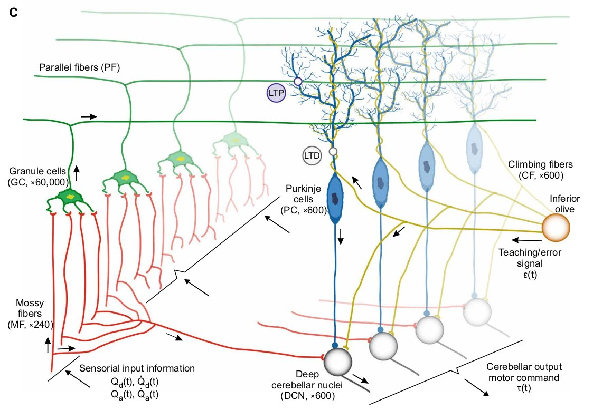
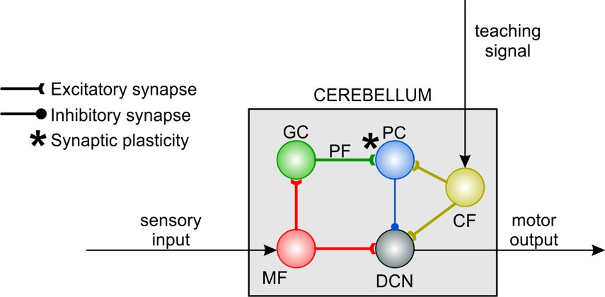
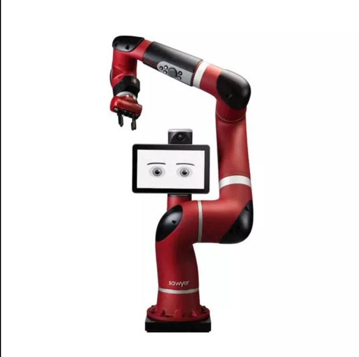
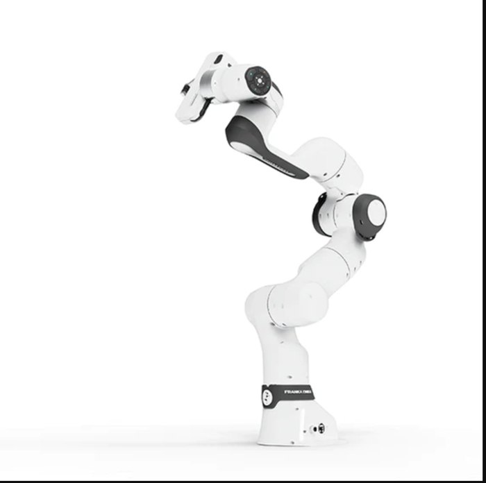
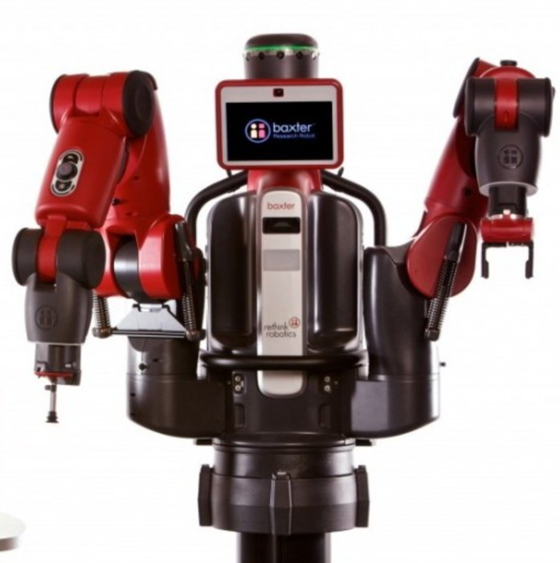
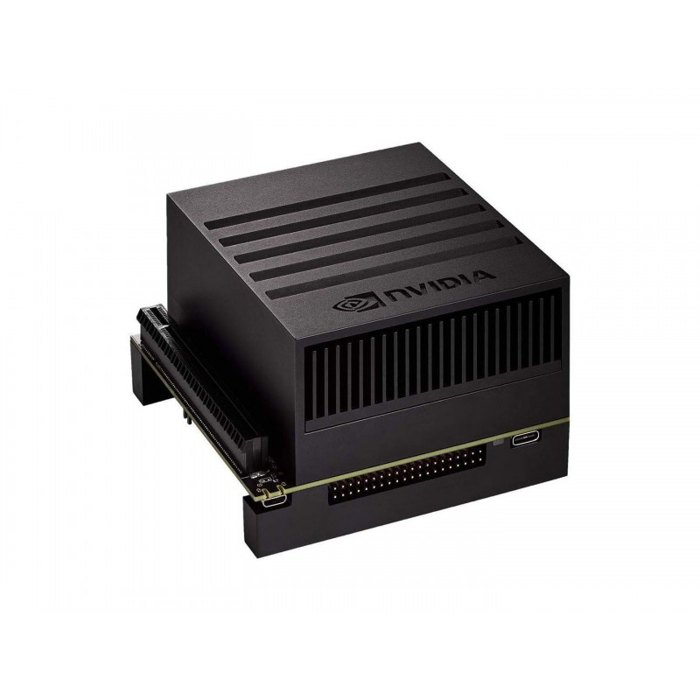

<a href="../">← All projects</a>

Project 1 · Neurorobotics

# Cerebellar SNN: motor learning from simulation to real robots

A 70,000+ neuron spiking cerebellum model that learns joint torque control in simulation and finishes learning on three real robots, at up to 500 Hz.

ROSEDLUTGazeboNeurorobotics PlatformGPUJetson Xavier / OrinVicon

| | |
|---|---|
| **Model** | Spiking neural network (SNN) mirroring the cerebellar circuit, 70,000+ neurons, joint torque output |
| **Robots** | Franka Research 3, Baxter, Sawyer |
| **Compute** | Desktop PC with GPU, Jetson Orin, Jetson Xavier |
| **Control rate** | PC 500 Hz · Jetson Orin 250 Hz · Jetson Xavier 100 Hz |
| **Sim-to-real** | ~450 trials (~30 min) in simulation, then ~80 trials on the real robot until the error converged |
| **My role** | Simulator bridge, GPU and Jetson deployment, real-robot experiments |

<figure><video src="../../assets/video/franka_circle.mp4" poster="../../assets/video/franka_circle.jpg" autoplay loop muted playsinline></video><figcaption>Franka Research 3 driven by the SNN on a Jetson Xavier, circular trajectory</figcaption></figure>
<figure class="tall"><video src="../../assets/video/baxter.mp4" poster="../../assets/video/baxter.jpg" autoplay loop muted playsinline></video><figcaption>Baxter, the hardest of the three robots</figcaption></figure>

## Requirements

- Learn **joint torque control** online with a cerebellum-inspired SNN.
- Run in **real time**: up to 500 Hz on a desktop GPU, and on embedded **Jetson** boards.
- **Never damage the robot** while the network is still learning.
- **One controller for several robots** with different, partly elastic dynamics.
- Measure performance **independently** of the robot's own sensors.

## The model

The network mirrors the cerebellar circuit (mossy fibers, granule cells, Purkinje cells, climbing fibers and deep cerebellar nuclei). It receives sensory input and an **error (teaching) signal**, and improves a movement by repeating it: supervised, trial-by-trial learning. Its output is a **joint torque command**, which is what makes this a real-time, safety-critical systems problem.

<figure><figcaption>Cerebellar microcircuit: parallel fibers, granule, Purkinje and nuclear cells</figcaption></figure>
<figure><figcaption>The simplified model: sensory input, teaching signal, motor output</figcaption></figure>

## Architecture

Network host<small>Desktop PC or Jetson Xavier / Orin runs the SNN (EDLUT, GPU)</small>

⟶<small>torques over ROS</small>

Robot or Gazebo<small>Franka Research 3 · Baxter · Sawyer</small>

⟶<small>end-effector pose</small>

Vicon cameras<small>independent ground truth</small>

The SNN runs in **EDLUT** and the robot in **Gazebo** or on hardware; the **Neurorobotics Platform (NRP)** connects them over ROS. A separate PC handles live plots so it does not load the network host.

<figure><video src="../../assets/video/sim_error.mp4" poster="../../assets/video/sim_error.jpg" autoplay loop muted playsinline></video><figcaption>Simulated arm learning a trajectory: error plots (top) and layer activity (bottom)</figcaption></figure>

## Key design decisions

| Decision | Alternative | Rationale |
|---|---|---|
| Couple EDLUT and Gazebo through the **NRP over ROS** | A custom simulator coupling | One ROS interface for simulation and hardware, so moving to the real robot is a **topic change**, not a code change |
| **Learn in simulation first**, then continue on hardware | Learn directly on the robot | Early learning produces erratic torques; simulation absorbs them, and only a stable network reaches the motors |
| **Safety by design**: the network's torque output is **bounded** | An external safety filter added afterwards | The controller cannot command torques outside its range, even while learning |
| **Scale network size and update rate per platform** | One configuration everywhere | Keeps real time on each target: PC 500 Hz, Orin 250 Hz, Xavier 100 Hz |
| Learn at **joint level**, validate in **Cartesian space with Vicon** | Rely on the robot's own encoders | An independent measurement of what the end effector actually does |
| Test on **three cobots** (Franka, Baxter, Sawyer) | Tune for a single robot | Shows the controller generalizes, including Baxter's elastic joints |

<figure class="sq"><figcaption>Sawyer</figcaption></figure>
<figure class="sq"><figcaption>Franka Research 3</figcaption></figure>
<figure class="sq"><figcaption>Baxter</figcaption></figure>
<figure class="sq"><figcaption>NVIDIA Jetson Xavier / Orin</figcaption></figure>

## Sim-to-real transfer

<figure><video src="../../assets/video/sim2real_1.mp4" poster="../../assets/video/sim2real_1.jpg" autoplay loop muted playsinline></video><figcaption>1 · Learning starts in simulation, where erratic motions are harmless</figcaption></figure>
<figure><video src="../../assets/video/sim2real_2.mp4" poster="../../assets/video/sim2real_2.jpg" autoplay loop muted playsinline></video><figcaption>2 · Once learning is stable, the weights are saved</figcaption></figure>
<figure><video src="../../assets/video/sim2real_3.mp4" poster="../../assets/video/sim2real_3.jpg" autoplay loop muted playsinline></video><figcaption>3 · The same network is loaded on the real robot by changing only the ROS topic</figcaption></figure>
<figure><video src="../../assets/video/sim2real_4.mp4" poster="../../assets/video/sim2real_4.jpg" autoplay loop muted playsinline></video><figcaption>4 · After ~80 more trials the error converges</figcaption></figure>

1. **Simulation:** ~450 trials of a 4 s trajectory, about **30 minutes**, until learning is stable.
2. **Save the weights** and load them on the real robot, changing only the ROS topic.
3. **Real robot:** learning continues, and the error converges after **~80 more trials**.

## Results

- **Franka Research 3** tracking a circular trajectory with the network running on a **Jetson Xavier**, verified with Vicon.
- **Baxter**, the most demanding dynamics of the three because of its external springs, controlled by the same network.
- Real-time control at **500 Hz (PC), 250 Hz (Jetson Orin) and 100 Hz (Jetson Xavier)**.

<figure><video src="../../assets/video/live_setup.mp4" poster="../../assets/video/live_setup.jpg" autoplay loop muted playsinline></video><figcaption>Monitoring screen during an experiment</figcaption></figure>

<a href="../">← All projects</a><a href="../dual-actuation-arm/">Next: Dual-actuation arm →</a>

