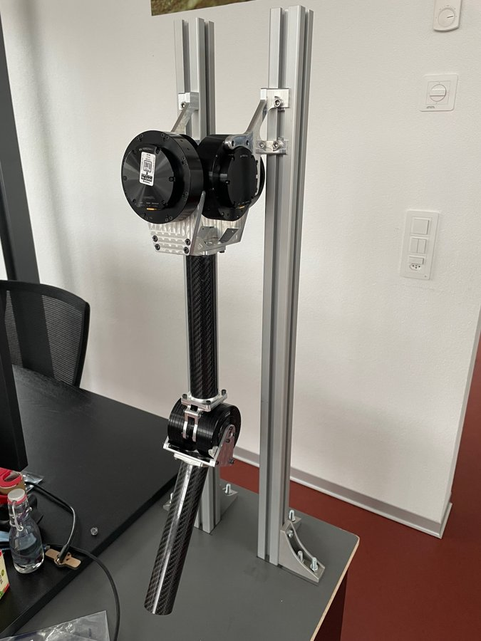
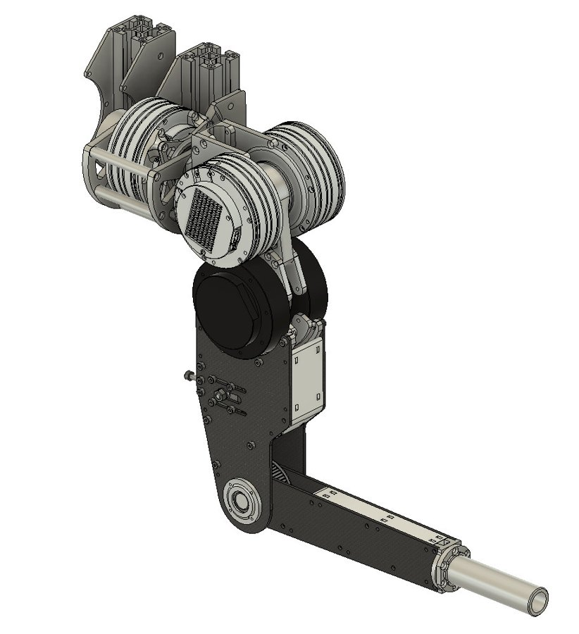

<a href="../">← All projects</a>

Project 2 · Robot software

# Dual-actuation arm: remote high-level interface

A remote ROS 2 interface that lets off-board neural controllers drive a research arm with muscle-like actuators, while the on-board controller stays pure C++.

RustZenohROS 2C++Raspberry Pi 4Torque control

| | |
|---|---|
| **Robot** | Research prototype with two actuators per joint (agonist and antagonist), designed from scratch |
| **What I built** | The remote side: a ROS 2 high-level interface on the PC and the command link to the arm |
| **Stack** | ROS 2 on the remote PC, Zenoh transport (Rust), pure C++ on the Raspberry Pi 4 |
| **Targets** | 1 kHz loop, torque control |
| **Context** | EPFL BioRobotics Laboratory visit (2025), with [KM-RoBoTa](https://km-robota.com/) on the hardware deployment |

## The robot

Each joint has an **agonist and an antagonist actuator**, mimicking human muscles. A pair of opposing actuators makes **adjustable joint stiffness** possible. The robot was designed from scratch; I joined when the software layer had to be built.

<figure><figcaption>Alpha version</figcaption></figure>
<figure><figcaption>New version (CAD)</figcaption></figure>

## Requirements

- Run **neural controllers off-board**: the Raspberry Pi 4 has no GPU.
- Expose the arm to **ROS 2 users** on a remote PC.
- Keep the **on-board software pure C++**, with no ROS 2 dependency.
- Exchange **commands, forward and inverse kinematics** between both computers.
- Designed for a **1 kHz** loop with **torque control**.

## Architecture

Remote PC<small>ROS 2 interface + neural controllers</small>

⇄<small>Zenoh</small>

Raspberry Pi 4<small>low-level control, pure C++</small>

⇄

Dual-actuation arm<small>agonist / antagonist actuators</small>

Controllers on the remote PC use a standard **ROS 2** interface. Zenoh carries commands and state between the PC and the Raspberry Pi, where the low-level controller runs in plain C++.

## Key design decisions

| Decision | Alternative | Rationale |
|---|---|---|
| **No ROS 2 on the Raspberry Pi**: on-board software in pure C++ (team decision) | Run ROS 2 on the robot | Keeps the embedded side lean and independent of the ROS 2 stack |
| **Zenoh** as the communication layer between PC and robot | ROS 2 / DDS end to end | Lets ROS 2 users on the PC reach a robot that does not run ROS 2, keeping both sides as compatible as possible |
| **Neural controllers on the remote PC** | Run them on board | The Raspberry Pi has no GPU; the PC provides the compute |
| **ROS 2 interface** on the remote side | A custom API | Any ROS 2 controller or tool can drive the arm without knowing the transport |

## Stiffness in action

The same arm **without stiffness** and **with stiffness**, controlled through the remote interface. Press play on either clip to compare.

<figure class="tall"><video src="../../assets/video/arm_nostiff.mp4" poster="../../assets/video/arm_nostiff.jpg" controls preload="none" muted playsinline></video><figcaption>① Without stiffness</figcaption></figure>
<figure class="tall"><video src="../../assets/video/arm_stiff.mp4" poster="../../assets/video/arm_stiff.jpg" controls preload="none" muted playsinline></video><figcaption>② With stiffness</figcaption></figure>

<a href="../cerebellar-snn/">← Previous: Cerebellar SNN</a><a href="../tiago-pro/">Next: TIAGo Pro →</a>

