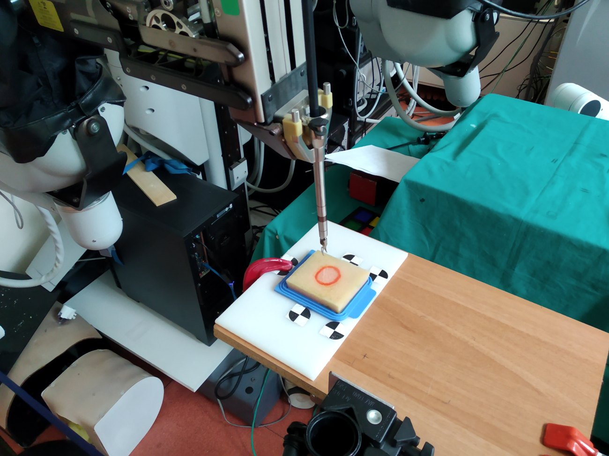
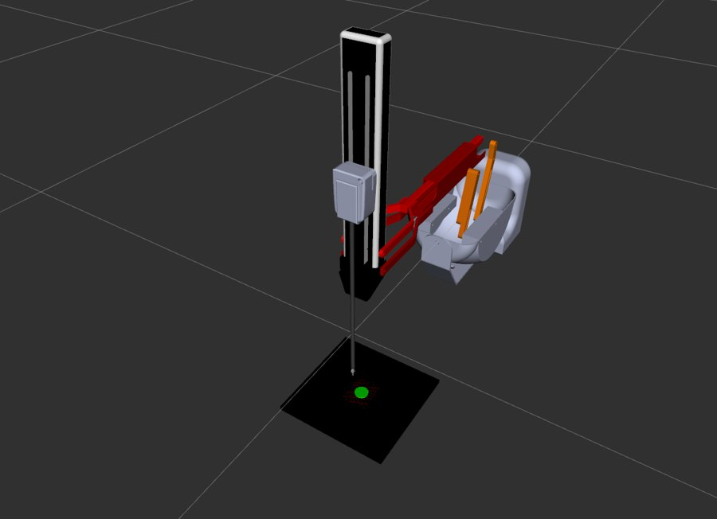
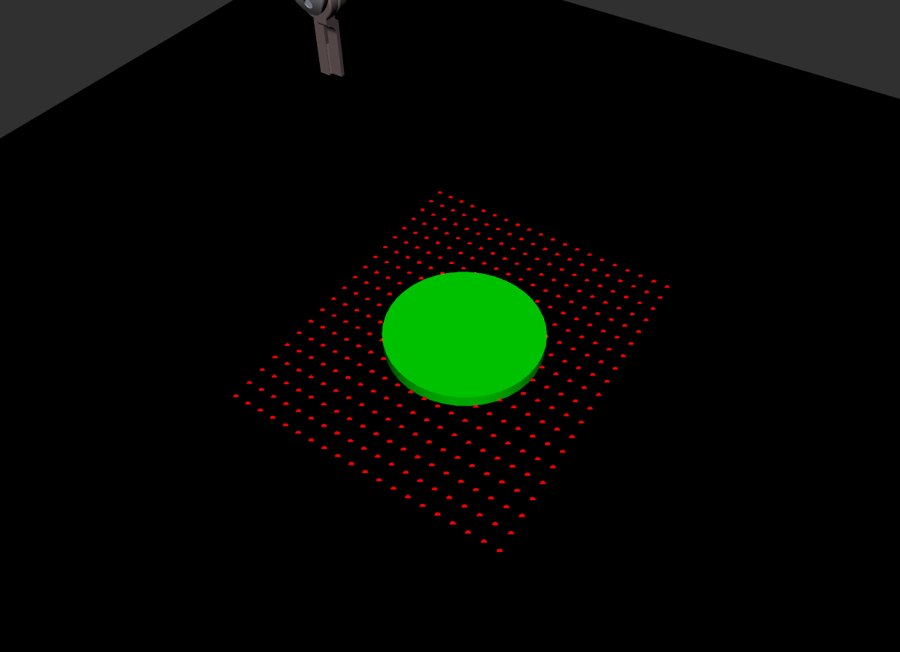
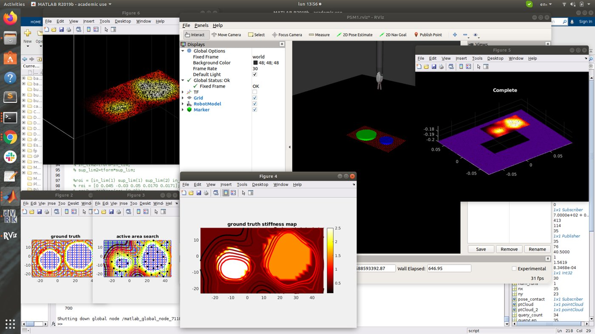
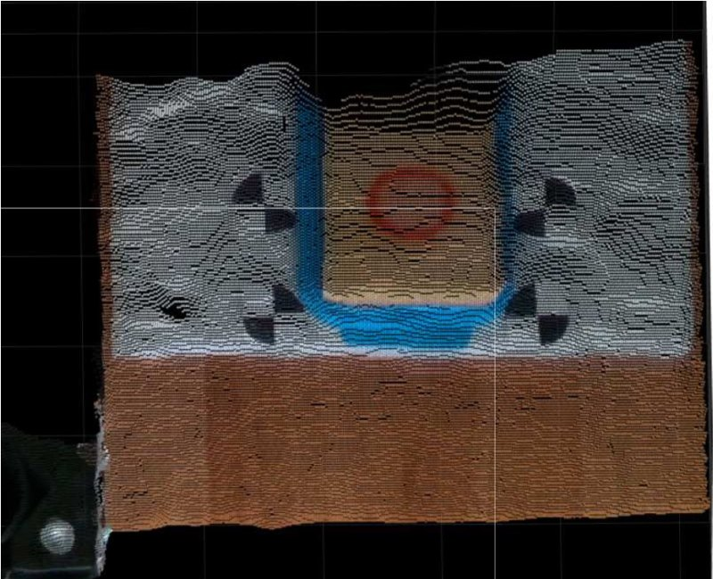
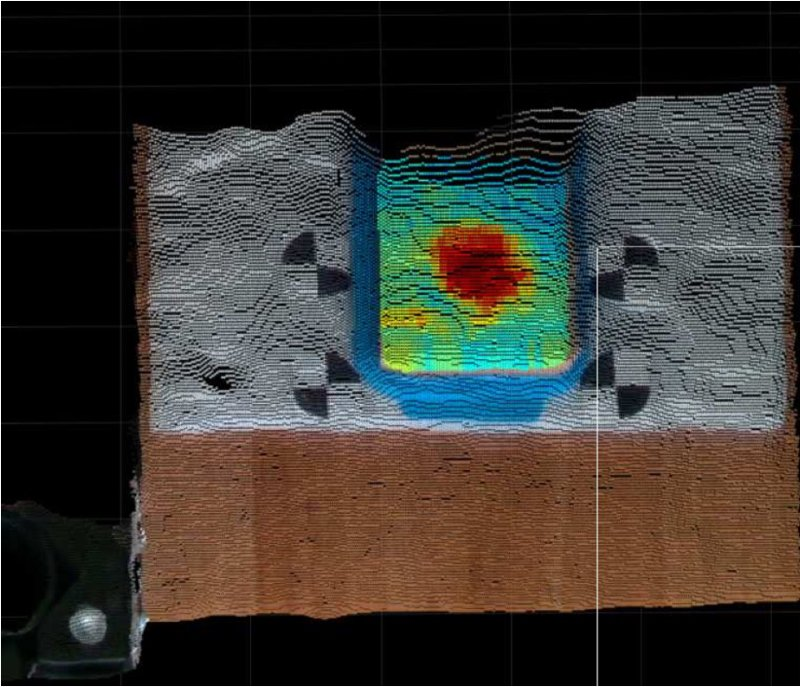
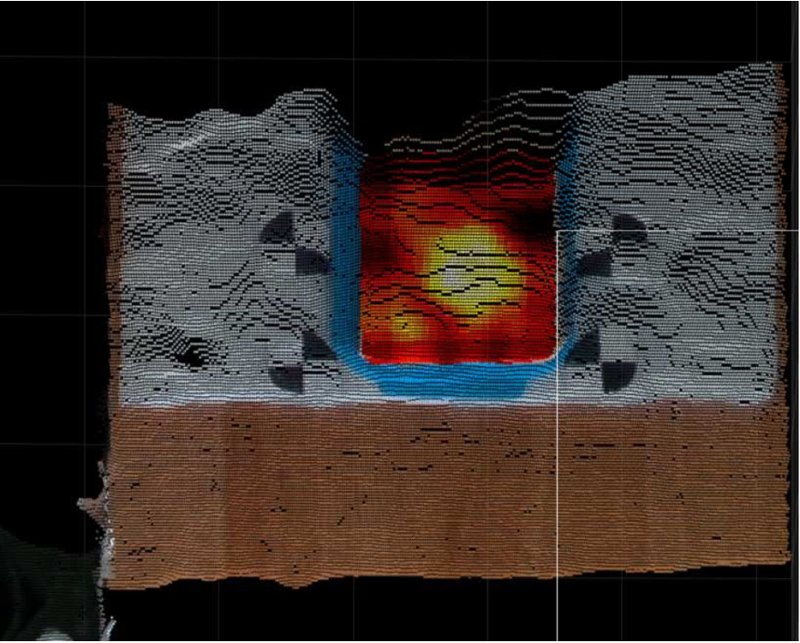

<a href="../">← All projects</a>

Project 4 · Medical robotics

# Tumor localization by bioimpedance palpation

A surgical robot locates a tumor by palpation and recovers its shape with only 25–50% of the samples, at recall above 90%.

dVRK PSM2ROSRVizMATLABGaussian ProcessElectrical bioimpedanceRealSense

| | |
|---|---|
| **Goal** | Locate a tumor beneath the tissue surface, where vision cannot see, for minimally invasive surgery |
| **Robot** | da Vinci Research Kit (dVRK), patient-side manipulator PSM2 |
| **Sensing** | Electrical bioimpedance (EBI) probe in direct tissue contact |
| **Planner** | Gaussian Process active area search (MATLAB) |
| **Result** | Tumor shape reconstructed with 25–50% of the samples, recall >90% against ground truth |
| **Context** | Visiting researcher, Altair Robotics Laboratory, Verona (Jan – Jul 2020) |

<figure><figcaption>Experimental setup: dVRK PSM2 palpating a sponge phantom with fiducial markers</figcaption></figure>

## Requirements

- Find and outline a tumor by **touch**, using bioimpedance (abnormal tissue reads differently from healthy tissue).
- **Minimize the number of palpations** compared with an exhaustive sweep.
- **Validate the software before** any trial on the physical robot.
- Measure accuracy against an **exhaustive ground truth** and show the result in **3D**.

## Architecture

1 · 3D acquisition<small>ROI point cloud and optical markers</small>

⟶

2 · Kinematics & simulation<small>dVRK PSM2 control in RViz / ROS</small>

⟶

3 · Robotic palpation<small>EBI probe in direct tissue contact</small>

⟶

4 · Active planner<small>Gaussian Process (MATLAB)</small>

⟶

5 · Map & validation<small>ground truth vs estimate</small>

ROS nodes synchronize the sensor, the manipulator and the planner. The region of interest is discretized in a **20 × 20 grid (400 points)**; the planner decides which cells actually need palpation.

## Key design decisions

| Decision | Alternative | Rationale |
|---|---|---|
| **Gaussian Process active area search** picks the next point to palpate | Exhaustive 20 × 20 sweep | Reconstructs the tumor with **25–50% of the samples** at recall above 90%, so far fewer contacts with the tissue |
| **ROS-based EBI sensor emulator** and an RViz model of the arm | Develop directly on the hardware | The whole pipeline (kinematics, safe trajectories, workspace, planner) is validated before any physical trial |
| **Fiducial markers + RealSense point cloud** | 2D maps only | Calibrates the camera and overlays the estimate on the 3D surface for validation |

<figure><figcaption>Digital model of the da Vinci arm in RViz</figcaption></figure>
<figure><figcaption>400-point grid with the simulated tumor (green cylinder)</figcaption></figure>

## Results

<figure><figcaption>Ground truth stiffness map vs active area search, with the RViz and MATLAB views</figcaption></figure>

<figure><figcaption>3D surface map: depth sensor, 4 fiducial markers, circular region of interest</figcaption></figure>
<figure><figcaption>Ground truth: exhaustive impedance map over the 3D relief</figcaption></figure>
<figure><figcaption>Planned estimate: reduced samples, same position and shape</figcaption></figure>

- The estimate reproduces the **position and concentric shape** of the tumor core (the high-impedance red-yellow region), with **recall above 90%** against the exhaustive ground truth.
- Achieved with **25–50% of the samples** of a full sweep.
- Reported experiments use a **sponge phantom**, with liquid soap and water to create the impedance contrast.

<a href="../tiago-pro/">← Previous: TIAGo Pro</a><a href="../formation-control/">Next: Formation control →</a>

